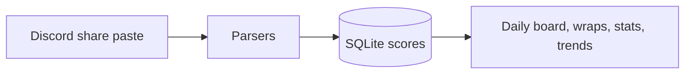

# LeleGamesStats

A self-hosted Discord bot for a private puzzle group: players paste native game-share text, and the bot turns it into one tidy daily leaderboard with points, wraps, stats, and history charts.




**Documentation:** [Scoring](SCORING.md) · [Command reference](docs/COMMANDS.md)

## What it does

- Turns recognized puzzle shares into canonical score records and replaces the channel clutter with a single, auto-updating daily board.
- Awards daily podium points, maintains weekly totals, and posts locked daily wraps with turnout, standings, and historical difficulty.
- Tracks all-time stats, play streaks, personal bests, head-to-head records, and recent game history.
- Renders compact Unicode charts for recent performance and adds a trend indicator based on historical percentiles.
- Provides an ephemeral daily checklist, alphabetized game catalog, CSV export, and self-serve or moderator corrections.
- Can optionally apply a first-attempt “prison” penalty in selected games; this affects daily points only, not the stored result.

## Quick start

### 1. Install Python dependencies

Use Python 3.10 or newer and a virtual environment:

```bash
python -m venv .venv
source .venv/bin/activate      # bash/zsh
# Windows PowerShell: .\.venv\Scripts\Activate.ps1
pip install -r requirements.txt
```

### 2. Create the Discord application

1. Create an application and bot at [Discord Developer Portal](https://discord.com/developers/applications).
2. Enable these privileged intents:
   - **Message Content Intent**
   - **Server Members Intent**
3. Invite the bot with both the `bot` and `applications.commands` scopes.
4. Give it these permissions in the results channel:
   - View Channels
   - Send Messages
   - Embed Links
   - Attach Files
   - Read Message History
   - Manage Messages

`Manage Messages` is required to delete raw pastes and manage the daily board pin.

### 3. Configure the bot

The bot reads environment variables at startup. There is no `.env` loader.

```bash
# bash/zsh
export DISCORD_BOT_TOKEN="your-bot-token"
export SCORE_CHANNEL_ID="123456789012345678"
export BOT_TZ="Europe/Warsaw"
```

```powershell
# Windows PowerShell
$env:DISCORD_BOT_TOKEN = "your-bot-token"
$env:SCORE_CHANNEL_ID = "123456789012345678"
$env:BOT_TZ = "Europe/Warsaw"
```

If you use a process manager, Docker, or a hosting panel, set the variables there instead.

### 4. Run and verify

```bash
python main.py
```

On startup, the bot initializes `scores.db`, syncs slash commands, and prints its login line. Post a supported native share text in the configured channel. The bot should acknowledge it, delete the raw paste, and create or update today’s board.

## Configuration

| Variable | Required | Default | Description |
|---|---|---|---|
| `DISCORD_BOT_TOKEN` | Yes | — | Discord bot token. Keep it secret; never commit it. |
| `SCORE_CHANNEL_ID` | Strongly recommended | Unset | Numeric ID of the results channel. When unset, message ingestion watches every guild text channel the bot can see. |
| `BOT_TZ` | Recommended | Server-local time | IANA timezone used for daily board dates, for example `Europe/Warsaw`. Invalid values fall back to server-local time. |
| `DISABLED_GAMES` | No | Empty | Comma-separated game prefixes to ignore, for example `Wordle,Chessle`. Disabled games are hidden from `/games` and `/missing`. |
| `PRISON_ENABLED` | No | Disabled | Set to `1`, `true`, `yes`, or `on` to enable the optional first-attempt prison penalty. See [Scoring](SCORING.md). |
| `DEBUG_LOG` | No | Disabled | Any non-empty value enables console diagnostics. `python main.py --debug` also enables it. |

## Using the bot

Post native share text in the results channel. Recognized results are stored under the current board date, the raw message is deleted, and a short acknowledgement shows the logged score and current placement. Ordinary chat and messages without a recognized score are left untouched.

Reposting a result for the same `(date, player, game, puzzle)` replaces the earlier result. The bot uses `BOT_TZ` for its own daily board date; puzzle sites may reset at a different time. `/games` shows the in-Discord reset information, including the Redactle exception.

## Commands

| Command | Purpose | Access / response |
|---|---|---|
| `/stats` | All-time stats, or a recent game-history chart with a performance trend. | Public all-time summary; game charts are private unless `public` is enabled. |
| `/h2h` | Head-to-head record across shared puzzle results. | Public. |
| `/missing` | Personal checklist of today’s available games. | Private. |
| `/games` | Alphabetized catalog of enabled games with links. | Private. |
| `/week` | Seven-day recap with turnout, weekly points, and difficulty. | Public. |
| `/wrap` | Posts the first available unwrapped day in the trailing week. | Public wrap; private confirmation. |
| `/board` | Reposts today’s board at the bottom of the channel. | Public board; private confirmation. |
| `/layout_switch` | Toggles today’s board between compact and wide layouts. | Public board; private confirmation. |
| `/undo` | Removes the caller’s most recent parsed ingest today. | Private confirmation; updates the public board. |
| `/forfeit` | Records a manual DNF for a game already played today. | Private confirmation; updates the public board. |
| `/remove` | Removes matching score entries for corrections. | Requires **Manage Messages**; posts a public removal notice. |
| `/export` | Exports recent score rows as a formula-safe CSV. | Requires **Manage Messages**; private attachment. |

All slash commands are guild-only. When `SCORE_CHANNEL_ID` is set, they are restricted to that channel. Full syntax, examples, and edge cases are in [docs/COMMANDS.md](docs/COMMANDS.md).

## Supported games

The bot supports more than twenty daily and weekly puzzle games across word, geography, music, trivia, history, estimation, and chess categories. Avoid relying on a copied list here: `/games` is the authoritative catalog of currently enabled games, with descriptions and play links.

Meaningful variants such as `Chessle (Medium)`, `Magnitudle (Size It Up)`, and `Roughly (Where from)` are kept separate where their scoring is not comparable. Thursday Thirty appears in `/missing` on Thursdays, but a shared result still counts on any day it is posted.

The full registry is in [`games.py`](games.py).

## Scoring

Daily points use a 3/2/1 podium per `(game, puzzle)`, with ties sharing placement. A puzzle must have at least two players for its results to earn points. Graded games such as Trivmount and History in Order have exceptions where partial results can compete.

Historical difficulty is separate from ranking and points: it compares today’s group performance with the same game and variant’s own recent history. It never changes `rank_score`, placements, or podium points.

Detailed formulas and ordering rules are in [SCORING.md](SCORING.md).

## Running and protecting your data

- SQLite data is stored in `scores.db` in the bot’s working directory. Use a persistent disk and keep the working directory stable.
- The database is not partitioned by guild or channel. Treat one database as one private group. Run only one bot process against a database.
- Startup creates missing tables and performs small migrations automatically.
- To back up, stop the bot and copy `scores.db`. Do not rely on `/export`; it is a recent-results CSV report, not a full database backup.
- Before upgrading, take a backup and check the current schema migration behavior in [`db.py`](db.py).

**Privacy and retention:** deleting a raw Discord paste is channel cleanup, not data deletion. `scores.db` retains scores, user IDs, display names, and `ingest_log` retains the raw message text and author information. `/undo` and `/remove` correct score data; they do not erase the ingest audit trail. Debug logs can also contain message content. Protect the database, backups, and logs like any other private group data.

## Development

Representative test commands:

```bash
python -X utf8 tests/test_parsers.py
python -X utf8 tests/test_stats_charts.py
python -X utf8 tests/test_trends.py
python -m unittest discover -s tests
```

Some suites are standalone scripts and others use `unittest`. When changing a parser, chart, or scoring rule, run the focused suite for that area and then run the unittest discovery pass.

| Module | Role |
|---|---|
| `main.py` | Bot entry point and wiring. |
| `config.py` | Environment configuration and board-date helpers. |
| `games.py` | Game registry, enabled games, chart families, and special rules. |
| `parsers.py` | Converts native share text into canonical result records. |
| `db.py` | SQLite schema, ingest audit trail, corrections, undo, and export. |
| `embeds.py` | Daily board, checklist, wrap, and weekly embed builders. |
| `handlers.py` | Discord message ingestion and daily board maintenance. |
| `commands.py` | Slash commands and response formatting. |
| `difficulty.py` | Historical difficulty calculations and personal trend calculations. |
| `stats_charts.py` | Game-history models, loaders, and Unicode chart renderers. |
| `tests/` | Focused regression suites. |

## Troubleshooting

- **The bot does not ingest messages.** Check Message Content Intent, `SCORE_CHANNEL_ID`, and whether the bot can view and read the channel.
- **Slash commands do not appear or respond.** Confirm the `applications.commands` scope, allow a moment for command sync, and use the configured results channel.
- **Raw pastes are not deleted.** The bot needs **Manage Messages** in that channel.
- **Difficulty labels are missing.** Historical difficulty requires enough prior history and at least two valid players for a puzzle; insufficient history is omitted rather than guessed.
- **The daily date seems wrong.** Set `BOT_TZ` explicitly. On Windows, `requirements.txt` installs the `tzdata` package needed for IANA timezone names.

## Contributing

Bug reports for parser failures are especially useful when they include the exact native share text, expected game and puzzle ID, and the date. Prefer sanitized examples if the original text contains private context.

For code changes, add or update a focused regression test and run the relevant suites before submitting.

## License

This project is licensed under the [PolyForm Noncommercial License 1.0.0](LICENSE). It is intended for personal and noncommercial use.
